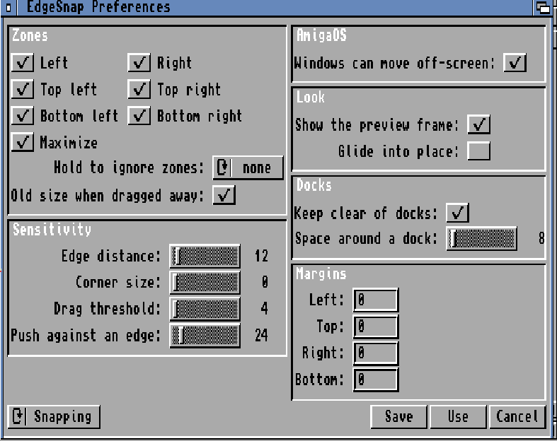

<!-- This README is the classic lane's own. At a merge from EdgeSnap keep
     this version, and carry over by hand only what applies to the 68k. -->
# EdgeSnap classic

**Author:** Michele Dipace <michele.dipace@kaffeine.net>
**License:** MIT (see [LICENSE](LICENSE))

Windows/macOS-style window snapping for the classic Amiga: AmigaOS 3.1
and later (it starts on 2.04) on the 68000 and up, with or without a
graphics card. Drag a window by its title bar until the pointer touches
a screen edge or corner: a frame shows where it will land, and letting
go fills that half or quarter of the screen. Docks are kept clear, two
windows side by side share a seam that resizes both, and hotkeys and an
ARexx port do the same from the keyboard and from scripts.

Written in C89. No system patches: a commodity input handler plus public
Intuition calls only. The behaviour lives in `edgesnap.library`, and the
commodity is its first client: any program can open the library and ask
for the same things.

*The preferences window on AmigaOS 3.2.3 (GadTools, 640x256), version 0.51.*

This repository is the classic lane of
[EdgeSnap](https://github.com/kaffeine1/edgesnap), the same project on
the other Amiga-like systems. It follows that repository: the shared
code, the engine and the library come from there by merge, and what is
classic lives here.

<!-- patreon-support:start -->
## Support development

EdgeSnap remains free and open source. You can [support my development work on Patreon](https://www.patreon.com/c/kaffeine1) to help fund testing, documentation and time spent improving it. No subscription is required to use the software, and public code, releases and articles remain available to everyone.

If you prefer a one-time contribution, you can [support my work on Ko-fi](https://ko-fi.com/kaffeine1).
<!-- patreon-support:end -->

## What it does

- drag a window so the **pointer** touches an edge or a corner: the
  frame previews the half, the quarter or the whole usable screen, and
  letting go snaps the window there;
- docks and panels are detected and never covered;
- two windows side by side share their edge: press the seam and drag
  it, and both are resized;
- a snapped window dragged away from the edges gets its old size back,
  under the pointer;
- hotkeys, each of which can be changed on the Hotkeys page of the
  preferences: `ctrl alt` with the cursor keys for left, right,
  maximize and restore, `ctrl alt c` for the window's own size in the
  middle of the screen, `ctrl alt z` for a selector under the pointer,
  nine cells that are the map of the screen;
- an ARexx port, `EDGESNAP`: `SNAP`, `RESTORE`, `QUERY`, `SELECT`,
  `PREFS`, `ENABLE`, `DISABLE`, `VERSION`, `HELP` and `QUIT`, on the
  active window or on one named by a `TITLE` pattern, for scripts, dock
  buttons and file managers;
- it is a commodity: it starts with the system from `SYS:WBStartup`,
  and Exchange enables, disables or removes it like any other;
- a preferences window in `SYS:Prefs`, built on GadTools so that it
  runs on 3.1 with nothing added; the same settings work as icon
  tooltypes, in `ENVARC:EdgeSnap.prefs` and on the command line
  (`EdgeSnap ZONES=halves EDGEPX=24`).

## Installing

Get `edgesnap.m68k-amigaos.lha` from Aminet (`util/cdity`), unpack it
and double-click the Install icon. It puts the library in `LIBS:`, the
commodity and its icon in `SYS:WBStartup`, the preferences in
`SYS:Prefs` and the manual where you say. Nothing is written to
`S:User-Startup`. Updating is installing again: no reboot needed.

**After the first installation on AmigaOS 3.2, restart the system.**
AmigaOS 3.2 keeps windows on the screen as installed: one dragged
against an edge stops there, and the pointer stops with it. The
installer turns on IControl's "Can Move Off-screen", which AmigaOS
takes up when it starts; EdgeSnap's preferences turn it back, in the
section named AmigaOS.

Where windows stop at the edge (until that restart, with the setting
off, and on 3.1 and earlier, which do not have it) push the mouse on a
little further against the edge and the frame comes up. How far is
"Push against an edge" in the preferences (`PUSHPX`, 24 pixels as it
comes); 0 turns the push off.

The glide into place is off as installed: 68k machines differ widely in
speed, and without a graphics card a glide can be slow. On AmiKit,
MCP's own window moving is turned off in `ENV:` while EdgeSnap runs, and
back on when it stops; the tooltype `KEEPMCP=YES` leaves MCP alone.

`EdgeSnap.guide` in the package says all of it in full.

## Status

**0.51 (2026-11-02)** is the first public release, with
`edgesnap.library` 2.28. It is a beta, complete in what it does. I
tested it on AmigaOS 3.2.3 under emulation (AGA and a graphics card)
and on 3.1 under emulation, and earlier versions on real hardware: an
A1200 as it came (68EC020, AGA), an A1200 with a Vampire and one with a
PiStorm running AmiKit. AmigaOS 3.1.4 has not been tried yet, and I
would like to hear how it does.

The classic releases carry the version of the EdgeSnap release they
come from, and the library is numbered above it: the history of the
2.x numbers, and which ones were classic, is in
`include/edgesnap_types.h`.

## What is different from the other systems

- `edgesnap.library` for 68k, with the jump table of
  `library/morphos/edgesnap_lib.fd`, register gates and its own
  version numbers.
- The preferences on GadTools (`prefs/gadtools/`).
- "Can Move Off-screen" turned on at the first installation, and the
  push against an edge counted from the mouse's own travel wherever
  windows may not leave the screen; where they may, the push does not
  count.
- The preview frame is drawn by the processor into the screen's memory
  in the accent colour, on AGA and on graphics cards alike
  (`commodity/frame_bits.c`).
- The glide off as installed, and MCP on AmiKit told to leave windows
  to Intuition while EdgeSnap runs (`commodity/mcp_config.c`).
- The manual is the shared one with the passages that differ here
  replaced at build time (`scripts/derive-68k-guide.py`), so it cannot
  fall behind.

## Building

- [m68k-amigaos-gcc](https://github.com/AmigaPorts/m68k-amigaos-gcc)
  6.5 with libnix and the NDK 3.2, plus `fd2sfd` and `sfdc`, in
  `~/amiga-dev/toolchain/bin` (or on the `PATH`).
- `scripts/build-m68k.sh` builds the library, the commodity, the
  preferences and the tools into `build/m68k/` (`Makefile.m68k`).
- `make -f Makefile.host test` runs the host tests of the core with any
  C compiler.
- `scripts/make-release-68k.sh` checks the versions, runs the tests and
  packs `build/EdgeSnap-68k-<version>.lha` with the Installer, the guide
  and the readme.

## For programmers

`edgesnap.library` places windows, says where a zone is, and finds and
moves the seam between two tiled windows. Its calls are the same on
every system EdgeSnap runs on; the public header is
[include/edgesnap.h](include/edgesnap.h), and the guide has a page for
programmers. `esnaptest`, in the m68k drawer of the package and in
[tools/esnaptest.c](tools/esnaptest.c), is a small client that drives
the whole API. [docs/DESIGN.md](docs/DESIGN.md) is the shared design:
why a commodity and a library, the input-handler rule and the roadmap.

## Layout

- `core/`: pure C89, zero Amiga dependencies, unit-tested on the host:
  zone geometry, the drag and snap engine, the snap registry
- `include/`: the public headers
- `library/edgesnap_body.c`: the one implementation behind the public
  API; `library/m68k/` wraps it as a 68k library
- `commodity/`: the commodity, the frame drawn into screen memory and
  the MCP handling
- `prefs/gadtools/`: the preferences window; `prefs/` holds what it
  shares with the other systems' preferences
- `catalogs/`: the locale catalog description and its translations
- `installer/Install`: the Installer script, shared with the other
  systems
- `tools/`: `esnaptest`, and the tools the test bench uses
- `scripts/`: `build-m68k.sh`, `make-release-68k.sh`,
  `stage-package-68k.sh`, `derive-68k-guide.py`

The other Makefiles, `library/os4`, `library/morphos`, `library/aros`
and the other preferences come with the merges from EdgeSnap and are
not part of the 68k build.

## Platform notes

- The CxCustom input handler runs in the input.device context: it only
  bumps counters and `Signal()`s the main task. All Intuition calls
  happen in the main task. Under `LockIBase()` we only read; the lock is
  dropped before any Intuition call, and a stored window pointer is
  never used without checking it against the screen's window list.
- The library has no startup code and no runtime: the resident tag is
  first in the file, and only the 68000's long multiply and divide come
  from libnix. The commodity and the preferences use libnix's small
  startup, with no ixemul.library at run time.
- One binary for the 68000 and later, so it runs on every machine the
  system itself runs on; `M68K_CPU=68020` builds a faster one.

## Prior art

On the classic Amiga the closest piece of prior art is **GoSnap**, a
commodity for AmigaOS 3.1.4 and later that snaps a window dragged to an
edge or a corner of the screen.

## Thanks

- **Carlo Spadoni** drew the commodity and preferences icons. His
  pictures are shipped as he drew them: `scripts/make-system-icons.py`
  only adds what a Workbench icon carries besides the picture, the
  type, the stack and the tooltypes, and the planar image older
  icon.library versions show.

## Reports

Problems on the classic systems go to
[this repository's issues](https://github.com/kaffeine1/edgesnap-classic/issues):
please say the machine, the system version and what you did.
